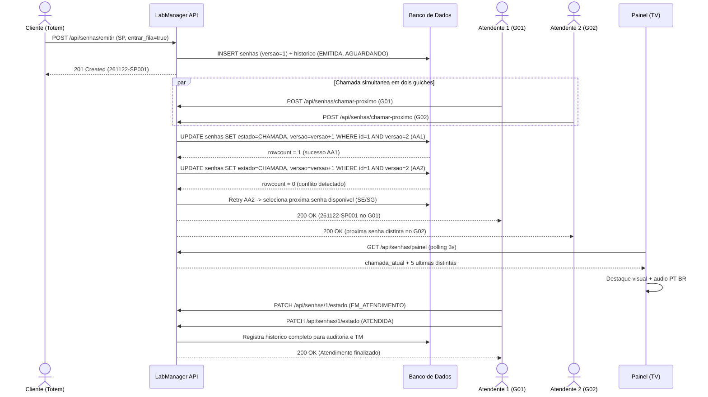

# Diagrama de Sequência — Fluxo Completo e Concorrência

Representa a emissão anônima no totem, a disputa simultânea entre dois atendentes protegida por lock otimista (`versao`), a atualização do painel e o encerramento do atendimento.

